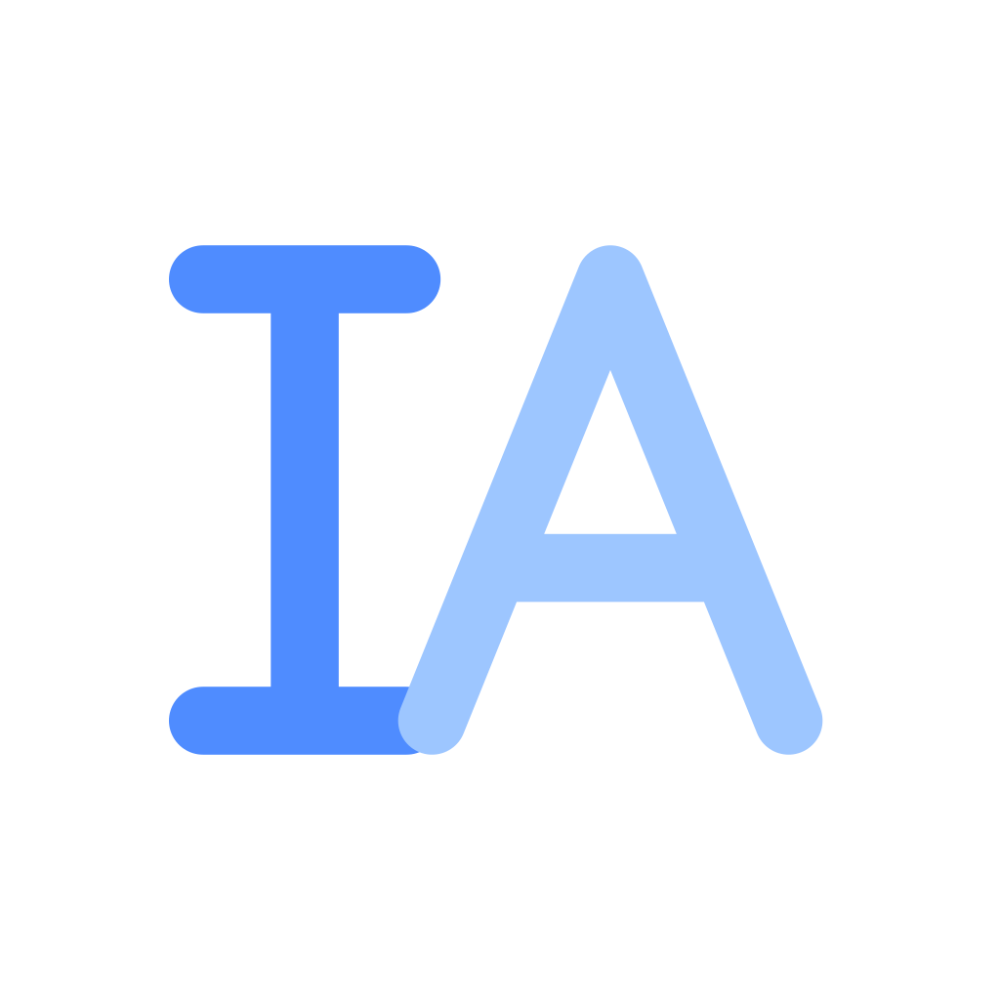

# InvestAtlas



The complete Shariah-aware personal investment app: run it locally or host your
own private instance. English, German and Arabic/RTL are supported.

**v1.2.4.** This source distribution includes the complete application, functional
tests, Node.js launcher, Docker packaging and self-hosting instructions.
Project repository: [haiderhamad/InvestAtlas](https://github.com/haiderhamad/InvestAtlas).
Current icons have documented original source and reproducible derivatives;
see [LICENSING](LICENSING.md). Dependency audit status and reporting guidance
are in [SECURITY](SECURITY.md).

## What it does

- Track accounts, transactions, holdings, allocation and portfolio development.
- Look up supported stocks, ETFs, crypto, gold and silver with source/time and
  honest unavailable/partial-data states; chart the history each source provides.
- Add individually resolved stocks/ETFs and review their Shariah evidence.
  A price or ticker match is not proof of compliance; missing evidence remains
  insufficient data.
- Use deterministic screening, purification estimates, tax profiles, technical
  indicators and planning tools where their required inputs are available.
- Export/import bounded CSV backups with conflict review.
- Connect your own supported market-data or AI keys. AI currently assists
  document/transaction extraction; a generative portfolio adviser is not included.

## Choose how to run it

| Mode | Use | Data and authentication |
|---|---|---|
| `local_personal` | Node.js or Docker on your computer | Browser-local data; no Firebase account required |
| `private_cloud` | Your own protected cloud deployment | Your Firebase project, exact owner UID and restrictive rules |
| `public_demo` | Optional illustrative website | Synthetic read-only data; no personal accounts or market APIs |

The public source repository supplies the complete app. The optional Demo mode
is one deployment choice. Each installation controls its own data and providers.

## Get the source

```sh
git clone https://github.com/haiderhamad/InvestAtlas.git
cd InvestAtlas
```

Alternatively, extract a source archive and open its project directory. Both
installation paths below start from that directory.

## Local installation with Node.js

Use Node.js **24.22.3+ within Node 24** (the
version in `.nvmrc`), or **26.13.1+ within Node 26**, with npm.

```sh
npm ci
npm run local
```

Open **http://127.0.0.1:3000**. The first start builds Local Personal mode; later
starts reuse a valid build. Stop with **Ctrl+C**. No `.env` file or cloud account
is required for this path. The JavaScript launcher also supports PowerShell.

If port 3000 is occupied, deliberately choose another stable address:

```sh
npm run local -- --port 3010
```

Use `npm run local:build` to build without serving. After updating the source,
run `npm ci` and `npm run local` again. Changed build inputs trigger a rebuild.

## Local installation with Docker

Install and start Docker with Compose support, then run:

```sh
docker compose up --build
```

Open **http://127.0.0.1:3000**. Node/npm are not required on the host. The image
is built from this source; no InvestAtlas registry image is assumed. Stop with
**Ctrl+C**, then `docker compose down` to remove this Compose service. After a
source update, run `docker compose up --build` again.

For an occupied port, create an untracked `.env` beside `compose.yaml` with
`INVESTATLAS_PORT=3010`, use the same command and open http://127.0.0.1:3010.
Compose aligns the published and internal app ports. Only loopback is published;
this does not enable phone/WLAN access.

## First use and backups

1. Review the in-app terms/privacy information.
2. Open Settings → Data & Sync → Data Sources and deliberately activate sources
   you are entitled to use, or connect your own supported keys.
3. Open Accounts and add a financial account, such as a brokerage, bank account
   or wallet, then enter or import its transactions. This is a portfolio record;
   Local Personal does not require a sign-in account. Charts can also be explored
   without recording a portfolio.

Local records stay in the **same browser profile and exact URL**. Different
hostnames or ports select different browser workspaces. Docker volumes do not
back up localStorage/IndexedDB. Records are not encrypted at rest; verify CSV
export/restore before relying on backups. Keys, AI analysis and market-history
caches are not included in CSV backups. Live data requires a network.

## Host your own private cloud

Follow [SELF_HOSTING](docs/SELF_HOSTING.md#mode-b-own-private-cloud-vercel-or-another-compatible-node-host).
Use your own hosting and Firebase project, with `private_cloud` at build and
runtime, an exact owner UID, generated owner-only Firestore rules and hosting
access protection. Vercel hosts the Next.js app; Firebase supplies identity and
cloud data storage. No owner account, credentials or portfolio data are supplied.

`.env.example` documents placeholders. Keep real secrets outside Git and browser
`NEXT_PUBLIC_*` variables. Your private repository can carry personal code
changes while taking updates from this public codebase; portfolio data and
credentials remain separately stored and backed up.

## Market data, limits and interpretation

Sources are explicitly activated per session. Yahoo is unofficial; activation
does not grant provider rights or bypass restrictions. Optional personal keys
depend on the user's plan, quota, CORS and listing coverage. Universal realtime
prices, an independent free metal backup and free five-year history for every
instrument are not promised. Gold/silver spot does not create historical candles.
Raw daily equity history may disable indicators because corporate actions can
distort the series. Source/time and limitations remain visible. See the coverage
and history sections in [SELF_HOSTING](docs/SELF_HOSTING.md).

Screening, purification and tax calculations depend on input/evidence quality.
Review the [Shariah screening protocol](docs/SHARIAH_SCREENING_PROTOCOL.md).
This is an informational tool, not financial, tax, legal or religious advice.

## Development checks

```sh
npm test -- --runInBand
npm run test:local
npm run icons:check
npm run typecheck
npm run lint
npm run i18n:check
npm run local:build
```

Cloud/Demo builds and optional emulator tests are documented in SELF_HOSTING.
The clean export excludes five private Git-history/publication-audit tests that
depend on excluded private history/manifests; functional/security tests remain.
Original private tests are not weakened or deleted. Emulator instructions do not
authorize changes to a live Firebase project.

## License

Apache License 2.0 applies to original source the owner is entitled to license.
See [LICENSE](LICENSE), [LICENSING](LICENSING.md) and
[THIRD_PARTY_NOTICES](THIRD_PARTY_NOTICES.md). Dependencies, fonts, trademarks,
icons and financial feeds retain their own terms. Source availability supplies
no provider subscription or redistribution permission.
