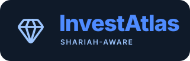
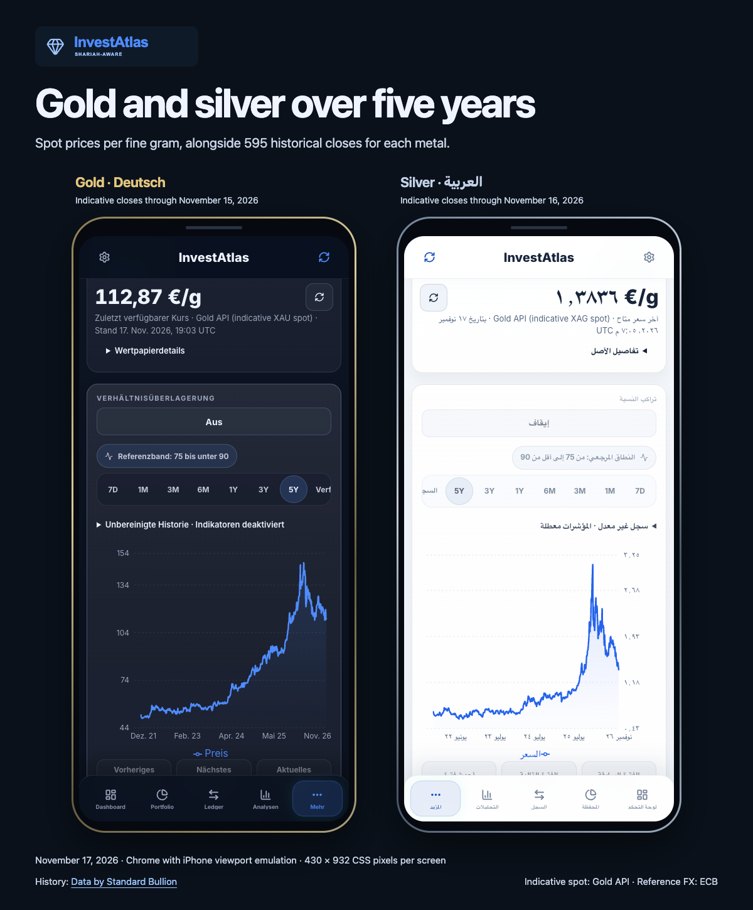
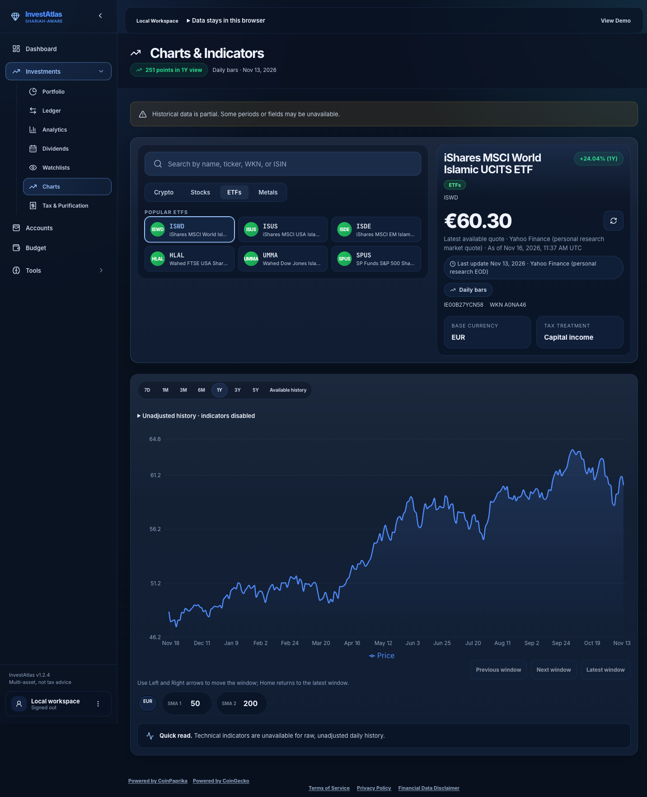
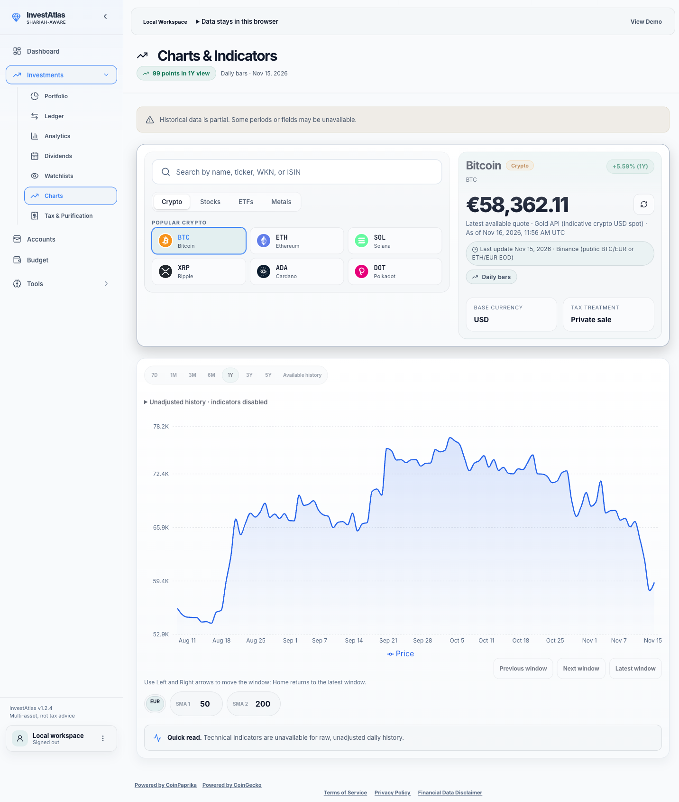

<p align="center">
  
</p>

<h1 align="center">InvestAtlas</h1>
<p align="center"><strong>Your portfolio. Your data. Your own instance.</strong></p>
<p align="center">A Shariah-aware investment workspace for stocks, ETFs, crypto, gold, silver and cash.<br>Run it locally with Node.js or Docker, or host your own private cloud.</p>

<p align="center">
  <a href="package.json"></a>
  <a href="#quick-start"></a>
  <a href="#docker"></a>
  <a href="#features"></a>
  <a href="LICENSE"></a>
</p>

<p align="center">
  <a href="#features">Features</a> · <a href="#screenshots">Screenshots</a> · <a href="#quick-start">Quick start</a> · <a href="#market-data-and-personal-api-keys">Market data &amp; API keys</a> · <a href="docs/SELF_HOSTING.md">Self-hosting guide</a> · <a href="SECURITY.md">Security</a>
</p>

<p align="center">
  <a href="docs/media/metals-iphone-pair.png"></a>
</p>
<p align="center">Historical closes · <a href="https://standardbullion.com/market-data">Data by Standard Bullion</a><br>Indicative spot · Gold API &nbsp;|&nbsp; EUR conversion · ECB</p>

InvestAtlas brings portfolio tracking, market research and transparent Shariah
screening into one personal workspace. It is built for investors who want to
understand both their holdings and the evidence behind a result. Missing prices,
incomplete history and insufficient screening evidence remain visible.

This repository contains the **complete application source**, functional tests,
local launcher, Docker packaging and cloud setup instructions. No account or
API key is required to start a local workspace or explore its separate demo.

## Features

### 💼 Portfolio and everyday finances

| Feature | What you can do |
| --- | --- |
| 📊 **Dashboard** | See current wealth, portfolio development, asset-class allocation and top holdings at a glance. |
| 🗂️ **Multi-asset portfolio** | Track stocks, ETFs, cryptocurrencies, physical gold/silver and cash across your financial accounts. |
| 🧾 **Accounts & ledger** | Record financial accounts and transactions, and derive holdings from the transaction ledger. |
| 💸 **Dividends & watchlists** | Review recorded dividend activity and keep personal lists of instruments to follow. |
| 🗓️ **Budget** | Organize income, expenses, categories and recurring entries across monthly, quarterly or annual views. |
| 📈 **Analytics** | Inspect sourced asset-class allocation, and compare returns with supported benchmarks when compatible history is available. |

### 🕌 Screening, research and planning

| Feature | What you can do |
| --- | --- |
| 🛡️ **Shariah audit** | Review the implemented screening methodology and its evidence states: compliant, non-compliant, review required or insufficient data. |
| 🔎 **Your own stocks & ETFs** | Search and resolve additional supported listings, use their available prices/history and inspect screening evidence. Finding a ticker or price does not establish Shariah compliance. |
| 🕯️ **Prices & charts** | Explore supported stock/ETF, crypto and metal data with currency, provider, observation time, selectable history ranges and clear coverage limits. |
| 🧼 **Tax & purification** | Work with tax-profile assumptions and purification estimates when the required inputs are known; missing data is kept distinct from a known zero. |
| 🧪 **Strategy Lab** | Explore deterministic single- and dual-moving-average strategies and crossover tools, with backtesting where suitable historical data is available. |
| 🎯 **Savings-plan tools** | Plan recurring contributions with your own budget and target percentages. Allocation decisions remain yours. |
| 🤖 **Optional AI import** | Connect your own supported AI provider to extract proposed transaction rows from a document, then review them before applying. |

### 🔐 A workspace you control

- **Local or private cloud:** use browser-local records without signing in, or
  configure a protected owner instance with your own Firebase project.
- **English, German and Arabic/RTL:** choose your language, light/dark theme and
  responsive desktop or mobile layout.
- **Portable CSV:** export and restore supported workspace records with duplicate
  and conflict review. Verify the documented size limits before relying on a backup.
- **Separate demo:** explore a dated, read-only synthetic portfolio without mixing
  it into your personal accounts or calculations.

Screening results describe the implemented methodology and available evidence;
they are not a religious ruling. See the
[Shariah screening protocol](docs/SHARIAH_SCREENING_PROTOCOL.md).

## Screenshots

### 📱 Gold and silver on mobile

Open either original screenshot to read the quote and explore the layout at full size.
Both were captured on November 17, 2026 in Chrome with an emulated iPhone viewport
of 430 × 932 CSS pixels. Each five-year chart shows 595 available closes.

| Original screenshot | Indicative spot price per fine gram | Quote time (UTC) | History through |
| --- | ---: | --- | --- |
| [Gold · German · dark](docs/media/gold-mobile-de.png) | €112.87 | 19:03 | Nov 15, 2026 |
| [Silver · Arabic · light](docs/media/silver-mobile-ar.png) | €1.3836 | 19:05 | Nov 16, 2026 |

Gold API supplies the spot observation, and the ECB reference rate supplies the
EUR conversion. The line connects available historical closes. Gaps in the
five-year window are possible. [Data by Standard Bullion](https://standardbullion.com/market-data).

### Desktop charts

| ETF · dark | Bitcoin · light |
| --- | --- |
| [](docs/media/etf-desktop.png) | [](docs/media/bitcoin-desktop.png) |

These desktop views were captured on November 16, 2026. All screenshots use an empty
Local Workspace with actual provider responses. [Capture details and image credits](docs/media/README.md).

## Quick start

Choose **Node.js** or **Docker** for local use. Both run the same application and
store your portfolio in the browser; Docker does not add server-side portfolio
storage. Cloud hosting is a separate option below.

### Node.js

Install Git, npm and patched **Node.js 24.22.3+ within Node 24** (the `.nvmrc`
preference), or **26.13.1+ within Node 26**.

```sh
git clone https://github.com/haiderhamad/InvestAtlas.git
cd InvestAtlas
npm ci
npm run local
```

Open **http://127.0.0.1:3000**. The first start builds Local Personal mode;
later starts reuse a valid build. Stop with **Ctrl+C**. No `.env` file, cloud
account or API key is required. The JavaScript launcher also supports PowerShell.

If port 3000 is occupied, deliberately choose another stable address:

```sh
npm run local -- --port 3010
```

Use `npm run local:build` to build without serving. After updating the source,
run `npm ci` and `npm run local` again; changed build inputs trigger a rebuild.

### Docker

Install and start Docker with Compose support. Host Node/npm are not required.

```sh
git clone https://github.com/haiderhamad/InvestAtlas.git
cd InvestAtlas
docker compose up --build
```

Open **http://127.0.0.1:3000**. The image is built from this source; no InvestAtlas
registry image is assumed. Stop with **Ctrl+C**, then `docker compose down` to
remove this Compose service. After updating source, run `docker compose up --build`.

For an occupied port, create an untracked `.env` beside `compose.yaml` containing
`INVESTATLAS_PORT=3010`, run the same command and open http://127.0.0.1:3010.
Compose aligns internal and published ports. It publishes only to loopback.

Phone access is an explicit trusted-WLAN setup, separate from the default local
launcher/Compose configuration. See [phone access](docs/SELF_HOSTING.md#optional-phone-access-over-trusted-wlan).

### First use

1. Review the in-app terms and privacy information. Use **View Demo** if you want
   to explore synthetic examples first, then **Start Local Workspace** for your records.
2. Under **Settings → Data & Sync → Data Sources**, activate sources you are
   entitled to use, or connect your own supported keys.
3. In **Accounts**, add a financial account such as a brokerage, bank account or
   wallet, then enter or import transactions. This records an account in your
   portfolio; Local Personal requires no sign-in. Charts also work without holdings.
4. Verify CSV export/restore under **Settings → Account → Account data** before
   relying on a backup.

Keep the **same browser profile and exact URL**. Different hostnames or ports
select different local workspaces. Records are not encrypted at rest, and
browser cleanup can erase them. Docker volumes do not back up browser data.
CSV excludes API keys, AI analysis and market-history caches. Live data needs
a network connection; local storage is not cross-device synchronization.

## Market data and personal API keys

| Source group | Implemented coverage |
| --- | --- |
| **Public sources, explicitly activated** | Yahoo stock/ETF quotes and EOD history; Gold API indicative gold/silver and BTC/ETH USD spot; separately approved Standard Bullion physical-metal daily close history; CoinPaprika with a CoinGecko spot fallback; Binance/Kraken completed daily history for supported BTC/ETH pairs. ECB supplies reference FX. |
| **Your market-data keys** | Tiingo, Twelve Data and Market Data API for their supported listings/capabilities; EODHD for compatible historical data. Plan, quota, listing identity and provider terms determine actual availability. |
| **History reuse** | Checked ranges are reused to avoid unnecessary downloads. Native EODHD history, Standard Bullion close observations and ECB reference rates can persist in device-local IndexedDB; Yahoo ranges stay in tab memory. Saved metal history is a dated, labelled fallback when refresh fails. |

Sources are deliberately selected per session. Providers have different listing,
currency, freshness and licensing constraints. Yahoo is unofficial. Universal
realtime coverage, free five-year history for every instrument and an independent
free physical-metal backup are not promised. Metal spot does not create candles;
raw equity history may be unsuitable for indicators because of corporate actions.
Standard Bullion history contains close observations, with unavailable OHLC and
volume left empty. Its required [Data by Standard Bullion](https://standardbullion.com/market-data)
credit accompanies the charts. The cached fallback is not a second independent feed.
Its validated five-year preset is saved once and reused for shorter chart ranges;
observations can be sparse, so this does not promise a full daily calendar.
The app keeps partial/unavailable states visible.

For AI-assisted document import, connect your own **OpenAI, Gemini, Groq or
OpenRouter** key. Local keys stay in tab memory; the cloud path uses authenticated,
encrypted provider storage. Only the selected highest-priority enabled provider
receives a document, with no automatic fallback forwarding. Review extracted
transactions before applying them. AI does not supply missing market data or
screening fundamentals, and a generative portfolio adviser is not included.

See [self-hosting](docs/SELF_HOSTING.md) for exact provider coverage, key handling,
history retention, CSV limits and unavailable states.

## Host your own private cloud

| Mode | Intended use | Data and authentication |
| --- | --- | --- |
| `local_personal` | Node.js or Docker on your computer | Browser-local records; no Firebase account required |
| `private_cloud` | Your own protected single-owner deployment | Your Firebase project, exact owner UID and restrictive rules |
| `public_demo` | Optional illustrative website | Synthetic read-only data; no personal accounts or market APIs |

Follow the [private-cloud guide](docs/SELF_HOSTING.md#mode-b-own-private-cloud-vercel-or-another-compatible-node-host).
Vercel hosts the Next.js app; Firebase supplies authentication and cloud storage.
Use your own projects, exact owner UID, owner-only Firestore rules and hosting
access protection. No owner account, credentials or portfolio data are supplied.

`.env.example` documents placeholders. Keep real secrets outside Git and browser
`NEXT_PUBLIC_*` variables. A separate private repository can hold your deployment
changes while taking updates from this public codebase; credentials and portfolio
backups remain separately stored.

## Built with

**Next.js · React · TypeScript · Tailwind CSS · Recharts**

Optional cloud services: **Firebase Authentication and Firestore**. Local mode
works without them. The app also includes a web manifest and PWA foundation;
live prices and portfolio analysis still require network access.

## Development and verification

```sh
npm test -- --runInBand
npm run test:local
npm run icons:check
npm run typecheck
npm run lint
npm run i18n:check
npm run local:build
```

Node and Docker installations were independently verified from fresh GitHub
clones on macOS ARM64 and Linux ARM64 for the v1.2.4 source publication. The
checks include production start/restart, HTTP boundaries and desktop/mobile
price/chart smoke tests. See [release status](RELEASE_STATUS.md) for scope and
[SECURITY](SECURITY.md) for the dated dependency audit and outstanding findings.

Cloud/Demo builds and optional emulator tests are in [SELF_HOSTING](docs/SELF_HOSTING.md).
The clean distribution excludes five tests tied to withheld private Git history
and publication-audit files; functional/security tests remain. Emulator instructions
do not authorize changes to a live Firebase project.

## License and financial information

[Apache License 2.0](LICENSE) applies to original source the owner is entitled
to license. See [LICENSING](LICENSING.md), [asset provenance](ASSET_PROVENANCE.json)
and [THIRD_PARTY_NOTICES](THIRD_PARTY_NOTICES.md). The README's Gem mark retains
Lucide's ISC notice; dependencies, fonts, trademarks and feeds keep their terms.
Source availability supplies no provider subscription or redistribution permission.

InvestAtlas is an informational tool. It provides no financial, investment,
tax, legal or religious advice. Calculations and screening depend on input and
evidence quality; review results before acting on them.
